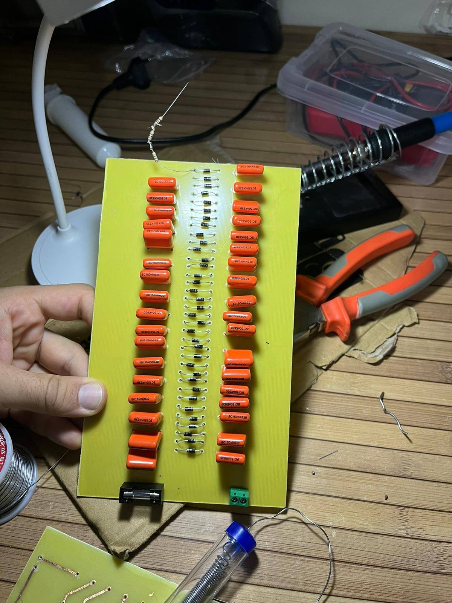
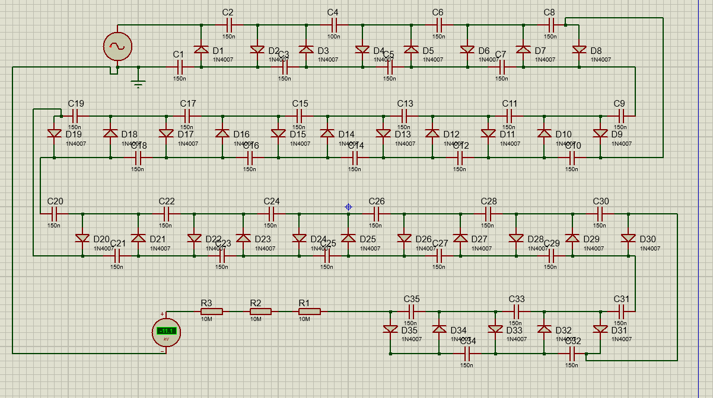
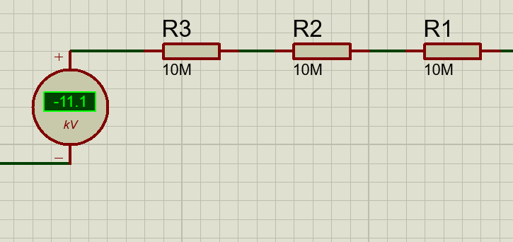
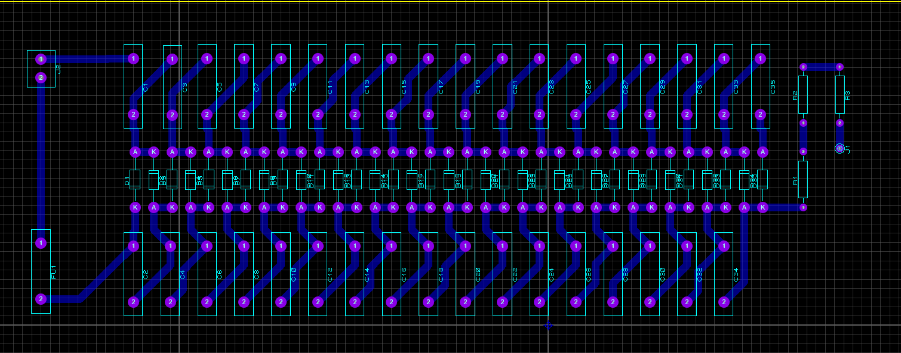

# Negatif İyonizer – Cockcroft-Walton Yüksek Gerilim Üreteci

230 V AC şebeke gerilimini 35 kademeli bir **Cockcroft-Walton gerilim katlayıcı** ile yaklaşık **−11 kV DC** gerilime yükselten ve korona boşalmasıyla havayı negatif iyonize eden devre. Yüksek Gerilim Tekniği dersi kapsamında tasarlandı, Proteus'ta simüle edildi ve PCB üzerinde üretildi.



> ⚠️ **Uyarı:** Bu devre transformatörsüz olarak doğrudan şebekeye bağlanır ve kV seviyesinde gerilim üretir. Kapasitörler devre kapatıldıktan sonra da yük tutabilir. Yalnızca yüksek gerilim konusunda deneyimliyseniz ve uygun güvenlik önlemleriyle çalışın.

## Çalışma prensibi

Giriş geriliminin her yarı periyodunda diyotlar kapasitörleri sırayla şarj eder ve kapasitör gerilimleri merdiven (kaskad) yapı boyunca üst üste eklenir. Her diyot çıkışa yaklaşık `Vmax` kadar katkı yapar. Çıkıştaki sivri uçta oluşan yüksek elektrik alanı korona boşalmasına yol açar; uçtan kopan elektronlar hava moleküllerine tutunarak negatif iyon oluşturur.



## Hesaplar ve sonuçlar

| Büyüklük | Değer |
|---|---|
| Giriş tepe gerilimi | Vmax = 230 · √2 ≈ 325,27 V |
| Teorik çıkış (ideal, yüksüz) | 35 · 325,27 V ≈ **11,38 kV** |
| Simülasyon çıkışı | **−11,1 kV** (teoriden ≈ %2,5 düşük; diyot düşümü ve ripple) |
| Koruma direnci | 3 × 10 MΩ seri = 30 MΩ |
| Teorik maks. temas akımı | 11 kV / 30 MΩ ≈ 0,37 mA (IEC 60479-1 algılama eşiğinin altında) |
| Simülasyonda kısa devre akımı | ≈ 57 µA (katlayıcının yüksek iç empedansı nedeniyle) |



## PCB

Yüksek gerilim yolları arasında yüzeysel atlamayı (creeping) önlemek için en az 2–3 mm yalıtım boşluğu bırakıldı. PCB toner transfer + asitle dağlama yöntemiyle üretildi.



## Malzeme listesi

| Bileşen | Adet | Özellik |
|---|---|---|
| Diyot | 35 | 1N4007 (1000 V / 1 A) |
| Kapasitör | 35 | 150 nF / 1000 V polyester |
| Direnç | 3 | 10 MΩ, 1/2 W |
| Sigorta | 1 | 200 mA cam sigorta |
| Klemens | 1 | 2'li PCB klemensi |

## Klasör yapısı

```
├── proteus/
│   ├── negatif_iyonizer.pdsprj       Proteus şema / simülasyon projesi
│   └── negatif_iyonizer_pcb.pdsprj   Simülasyon grafikleri ve PCB yerleşimini içeren proje
└── docs/
    ├── negatif_iyonizer_rapor.docx   Proje raporu
    ├── pcb_baski_maskesi.pdf         Toner transfer için baskı çıktısı
    └── images/                       Şema, PCB, simülasyon ve devre görselleri
```

## Kullanılan araçlar
Proteus (ISIS + ARES) · toner transfer ile ev tipi PCB üretimi
